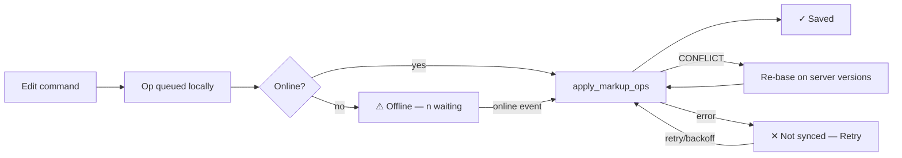
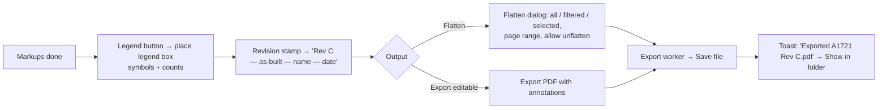
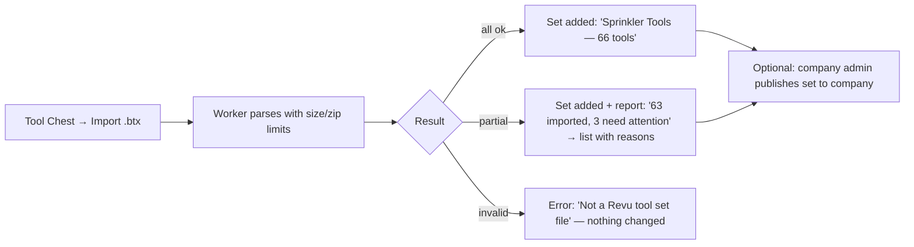

---
stepsCompleted:
  - step-01-init
  - step-02-discovery
  - step-03-core-experience
  - step-04-emotional-response
  - step-05-inspiration
  - step-06-design-system
  - step-07-defining-experience
  - step-08-visual-foundation
  - step-09-design-directions
  - step-10-user-journeys
  - step-11-component-strategy
  - step-12-ux-patterns
  - step-13-responsive-accessibility
  - step-14-complete
lastStep: 14
status: complete
completedAt: 2026-10-17
inputDocuments:
  - _bmad-output/planning-artifacts/prd.md
  - _bmad-output/planning-artifacts/architecture.md
  - docs/feature-inventory.md
  - docs/prior-art-sprinkler-drafter.md
  - docs/4541-placement-design.md
---

# UX Design Specification plan-markup

**Author:** Cchoi
**Date:** 2026-10-16

---

## Executive Summary

### Project Vision

plan-markup is a browser-based PDF drawing workspace for fire protection contractors and designers. It does the slice of Bluebeam Revu that fire drawing work actually uses — markup, calibrated measurement, a symbol Tool Chest, a Markups List, page editing, flatten/export — and adds a 4541 engine that places sprinkler heads automatically within NZS 4541 rules. The UX promise: **a Revu user feels at home on first open, a new user finishes a job without training, and nothing is ever lost.**

### Target Users

- **As-built drafter (primary, J1/J2):** uses Revu daily, fluent in its layout and muscle memory; wants the same structure without the licence, install and unused menus. Works at an office desktop with **one monitor** and a mouse (no site/laptop use yet), on large A1/A0 sheets in long sessions. Layout baseline: one 1920×1080 screen; minimum 1280×720 (NFR42).
- **Sprinkler designer (J6):** same person in design mode; wants zone → place heads → verify coverage → tweak, faster than spacing heads by hand with measure tools.
- **Company admin (J3):** occasional visits; manages members and publishes company tool sets.
- **Viewer / reviewer (J4):** main-contractor PM; opens a shared link, sets status, comments; never draws; may not have the PDF.
- **Platform admin (J5):** the founder; onboarding, activity metrics, support lookup without seeing drawings.

### Scope Notes (founder, 2026-10-16)

- **Basic keyboard shortcuts ship in MVP** (select, pan with Space, undo/redo, delete, escape, Shift angle constrain, zoom); full and customisable shortcuts stay post-MVP.
- **Tile alignment** exists only inside 4541 placement (user-declared grid, tile centre); general markup tile snapping is post-MVP.
- **Desktop only** for now; no field/tablet use. Offline handling stays as architected (network drops), not a field-first design.

### Key Design Challenges

1. **Familiar but not a clone:** reproduce Revu's structure (2-row top toolbar, right tool rail, left panel rail, bottom Markups List, status bar) closely enough for muscle memory, with original visuals (clean-room).
2. **Invisible persistence made visible:** markups follow the exact PDF file; a re-saved PDF opens as a new drawing. Users must always understand save/sync/offline state and why markups "disappeared" (FR81 hint) without reading docs.
3. **Scale trust:** detected scale, verify, per-page calibration, "Scale not set" — measurement must never silently be wrong.
4. **4541 panel density:** zones, use → hazard, preferences, pattern (rectangular/staggered), tile alignment, overlay, per-zone report and warnings — with a defaults-only path to "Place heads" (A14).
5. **Dense canvas performance as UX:** A1 vector sheets (~180k paths) must feel instant; progressive rendering states replace spinners.
6. **Markup-only view for viewers** without the PDF must still make sense.

### Design Opportunities

1. **First-run in under a minute:** drag PDF → scale detected → confirm → first stamp, guided inline (no tour).
2. **Status bar as the trust centre:** scale, save state (`Saved` / `Saving…` / `Offline — n pending`), snap toggles, page size — one place to glance.
3. **4541 as a single flow:** select zones → Place heads → coverage overlay on by default → warnings inline on the canvas next to the offending head/wall.
4. **Calmer than Revu:** fewer, better-grouped tools; dark near-sharp workspace that keeps the drawing the brightest thing on screen.

## Core User Experience

### Defining Experience

The core loop is **calibrated measuring and symbol placement on a drawing**. Founder-ranked frequency (2026-10-16):

1. **Measure** (length, area) — the most frequent action; must be exact and instant.
2. **Stamp devices from the Tool Chest** (heads, detectors).
3. **White-out / erase** original design content.
4. **Cloud + text** for changes.
5. **Polyline pipework + size labels.**

The founder has **no complaints about Revu's interaction model**. Therefore the markup/measure experience targets **behavioural parity with Revu**, not reinvention: same tool placement in the layout, same click semantics (click-click for lines, double-click/Enter to finish polylines and areas, Esc to cancel, Shift to constrain), same caption behaviour, same Markups List columns. "Better" is not redesigned interactions — it is **(a) no install / instant open, and (b) the 4541 engine, which Revu does not have.**

### Platform Strategy

- Desktop web app, Chrome/Edge first (NFR42), mouse + keyboard; one monitor, 1920×1080 baseline, 1280×720 minimum.
- No touch, tablet or field mode in MVP.
- Local-first: the PDF stays in the browser; markups sync in the background; network drops are tolerated (queue), but there is no field-offline design.
- Leverage the browser: drag-and-drop open, File System Access where available to reopen recent files, Web Workers for rendering and engines.

### Effortless Interactions

- **Measure with zero doubt:** current scale always visible in the status bar; uncalibrated pages show "Scale not set" in the warning colour (yellow + icon) instead of numbers (J2); measurement values update live while drawing; snap to vector endpoints/intersections by default.
- **Stamp in one click:** pick a Tool Chest item once, keep clicking to place copies at the correct scale (devices sized in real units, not pixels); Esc returns to Select.
- **White-out in a drag:** rectangle/polygon white-out that hides original linework visually (MVP decision), then continue working.
- **Cloud + text** as one tool (cloud+) like Revu.
- **Nothing to save:** autosave always; save state visible, never a dialog.
- **Reopen = continue:** opening the same PDF restores everything; a different file explains why it is clean (FR81 hint).

### Critical Success Moments

1. **First measurement is correct** — scale detected/confirmed, first length matches a known dimension. If this fails, trust is gone.
2. **First stamp lands at the right size** — imported Revu tool set looks and scales as it did in Revu (`.btx` fidelity, A9).
3. **Reopen next day** — all markups are there.
4. **"Place heads" moment (the wow)** — zones filled, one click, heads appear in every zone including irregular ones, coverage overlay shows no gaps, warnings (if any) point at the exact place. This is the moment the user realises it is better than Revu.
5. **Export opens cleanly in Revu/Acrobat** — flattened or editable annotations as chosen.

### Experience Principles

1. **Revu parity for the core loop** — when in doubt, behave like Revu; do not invent new interaction patterns for measure, stamp, white-out, cloud or polyline.
2. **Accuracy is visible** — scale, units and calibration state are always on screen; never show a number that could be wrong without flagging it.
3. **The 4541 engine is the showcase** — it gets the most UX design attention: a defaults-only one-click path, then progressive controls.
4. **Never lose work, never ask to save** — autosave + visible sync state.
5. **The drawing is the hero** — dark, quiet chrome; the sheet is the brightest thing on screen.

## Desired Emotional Response

### Primary Emotional Goals

- **Confident and in control** — "the numbers are right and I know what the app is doing." Professional users stake their name on these drawings; trust beats delight.
- **At home** — a Revu user's hands already know where things are.
- **Impressed, once, at the right moment** — the 4541 "Place heads" result is the one place the product is allowed to wow.

### Emotional Journey Mapping

| Stage | Desired feeling | Avoid |
|---|---|---|
| First open (drag PDF in) | "That was fast, and it looks like Revu." | Overwhelm, sign-up friction before value |
| Calibrate / first measure | Certainty — the number matches the dimension. | Doubt about scale or units |
| Core loop (measure, stamp, white-out, cloud, pipe) | Flow — no thinking about the tool. | Hunting for tools, unexpected snapping |
| 4541 Place heads | Surprise + relief — "it did an hour of work in a second." | Suspicion that the layout is non-compliant without saying so |
| Something goes wrong (offline, wrong file, infeasible zone) | Informed and calm — told what happened, what is safe, what to do. | Panic about lost work, blame-y error text |
| Export / reopen next day | Accomplished — clean output, everything still there. | "Where did my markups go?" |

### Micro-Emotions

Most critical for this product, in order:
1. **Trust vs scepticism** — measurements, saved state, 4541 compliance report.
2. **Confidence vs confusion** — familiar layout, explicit states.
3. **Accomplishment vs frustration** — export and reopen.
Delight is secondary and reserved for the 4541 moment.

### Design Implications

- **Trust →** scale and save state always visible in the status bar; warning-yellow "Scale not set" instead of numbers; per-zone report with figures and the rule-figure version; advisory notice that is present but not nagging.
- **At home →** Revu-parity layout and tool semantics (step 3); Revu terms where they are industry vocabulary (Tool Chest, Markups List, Flatten, Calibrate).
- **Calm when things fail →** errors state what happened, what is safe ("Your markups are saved locally — 3 changes waiting to sync") and one next action; never modal unless data is at risk.
- **Wow at 4541 →** heads appear with a short staged reveal per zone and the coverage overlay fades in automatically; warnings are pinned to the exact head/wall on the canvas, not hidden in a dialog.
- **No anxiety about saving →** no save button; sync indicator; reopen restores silently; different-file hint explains instead of looking like data loss.

### Emotional Design Principles

1. **Earn trust before delight.**
2. **Say what is safe** in every error and warning.
3. **One wow, well placed** — 4541; everything else is quiet and fast.
4. **Familiar words, familiar places.**

## UX Pattern Analysis & Inspiration

### Inspiring Products Analysis

**Bluebeam Revu 21 (primary reference — structure and behaviour only, clean-room).**
- Founder's favourite parts to preserve: **Flatten** and **Measure**.
  - *Flatten:* one command with a clear dialog (which markups, page range, allow unflatten), predictable output that opens anywhere.
  - *Measure:* calibrate once per page/viewport, measurement tools in one group, live value while drawing, caption on the markup, Measurements panel with totals.
- Layout the founder uses daily: 2-row top toolbar, right vertical tool rail, left icon rail (Tool Chest, Measurements), bottom Markups List, status bar with page size and scale.
- Weaknesses to avoid: install/licence friction, menus the user never uses, dense settings dialogs.

**Procore / PlanGrid (construction field-collaboration apps).**
- Strong at: sheet-based navigation (sheet number + title rather than page index), sharing a drawing with a reviewer who only needs to look, status and comments on items, clear "latest revision" signalling.
- Viewer experience is simple: open link → see the sheet → act on items; no drawing tools in the way.
- Weaknesses for us: cloud-first (drawings uploaded), lighter markup/measure precision than Revu.

### Transferable UX Patterns

**Navigation**
- Revu panel layout (top toolbar rows, right tool rail, left panel rail, bottom Markups List, status bar) — adopt structure.
- Procore/PlanGrid-style **sheet labels** in thumbnails, the pager and Markups List ("A1721 — Level 17 RCP" from page label / title block text when available, page index as fallback). Document tabs show the **file name** (truncated; full name in the tooltip). Founder decision 2026-10-23: a sheet label would rename the tab on every page of a set.

**Interaction**
- Revu measure flow: choose tool → live value → finish → caption; calibrate dialog with detected-scale suggestion.
- Revu flatten dialog: scope (all / filtered / selected), page range, allow unflatten, then export.
- Procore/PlanGrid reviewer flow: shared link → read-only canvas → status + comment on a markup from the list or canvas.

**Visual**
- Dark workspace chrome with the sheet as the brightest element (Revu-like), near-sharp tokens.
- Status colours used sparingly and consistently (yellow = needs attention, e.g. scale not set; red = rule break; green = verified/synced; brand orange is reserved for accent/selection — see Visual Design Foundation).

### Anti-Patterns to Avoid

- Hiding scale/calibration state (leads to silently wrong numbers).
- Save dialogs or "unsaved changes" prompts — we autosave.
- Modal wizards for routine actions (flatten, calibrate are quick dialogs, not multi-step wizards).
- Upload-first flows (Procore/PlanGrid) — conflicts with drawings-stay-local.
- Tool sprawl: showing every Revu tool; we show the fire-work subset.
- Reviewer screens cluttered with drawing tools.

### Design Inspiration Strategy

**Adopt:** Revu layout structure, Revu measure flow and flatten dialog semantics, Revu tool/term names that are industry vocabulary.

**Adapt:** Procore/PlanGrid sheet labelling and reviewer flow, adapted to local-first (markup-only view when the PDF is not stored); Revu Markups List columns, trimmed to the founder's set.

**Avoid:** install/licence friction, upload-first flows, hidden scale state, save prompts, multi-step wizards for routine tasks.

## Design System Foundation

### 1.1 Design System Choice

**Custom token layer on Tailwind v4 + headless accessible primitives.**
- Tokens: Tailwind v4 `@theme` in `src/app/globals.css` — colours, near-sharp radii, hard offset shadows, spacing, type scale, z-layers; dark workspace / light admin themes (FR69).
- Behaviour primitives: **Radix UI** (`radix-ui` 1.8.1) for menus, dropdowns, dialogs, popovers, tooltips, tabs, toggle groups, context menus, sliders — unstyled, keyboard and screen-reader correct (NFR43).
- UI icons: **lucide-react** 1.58.0 for chrome (toolbar, panels, status bar). Fire device symbols are **data** (Tool Chest), never icons in code.
- Canvas content (markups, handles, overlays) is drawn by the custom Canvas2D renderer and styled from the same tokens via a small JS token export.

### Rationale for Selection

- Revu-like dense workspace chrome is not what Material/Ant/MUI are built for; their density, radii and shadows fight the near-sharp style and would need heavy overrides.
- shadcn/ui defaults (large radius, blurred shadows) conflict with near-sharp; using Radix directly gives the same accessibility without restyling a design language.
- Founder's proven pattern (Fire Impairment Manager): Tailwind tokens + near-sharp scale already worked; one solo founder + AI agents need a small, explicit token set.
- Headless primitives keep keyboard reachability (NFR43) and the basic shortcut set reliable without hand-rolled focus management.

### Implementation Approach

- `src/components/ui/*` wraps Radix primitives with tokens: `Button`, `IconButton`, `ToggleButton` (tool rail), `Toolbar`, `Menu`, `ContextMenu`, `Dialog`, `Popover`, `Tooltip`, `Tabs`, `Select`, `NumberField` (with units), `ColorSwatch`, `Slider`, `Panel` (collapsible, resizable), `StatusBarItem`, `Toast`, `Table` (Markups List, virtualised).
- Workspace components in `src/features/*` compose these; no feature styles raw HTML controls directly.
- Tokens exported once to TS (`src/components/ui/tokens.ts`) for the canvas renderer (selection colour, handle size, overlay colours).

### Customization Strategy

- **Near-sharp scale (founder preference):** radius 2 px (controls), 3 px (cards/panels), 4 px max; shadows hard offset with zero blur (2px 2px 0 … 8px 8px 0, 6–12% opacity); focus `ring-2` everywhere.
- **Workspace (dark):** neutral dark greys for chrome so the white sheet is the brightest element; one accent colour for active tool/selection; semantic yellow (attention), red (rule break/error), green (verified/synced) used sparingly.
- **Admin & marketing (light):** same tokens, light surface set.
- **Density:** compact by default in the workspace (28–32 px toolbar buttons, 12–13 px UI text); comfortable in admin/marketing.
- **Clean-room:** layout structure follows Revu; icons, colours, typography and component visuals are our own.

## 2. Core User Experience

### 2.1 Defining Experience

Two defining interactions, one established and one novel:

1. **"Measure it and trust the number"** (daily, established) — calibrated length/area measurement with Revu-parity mechanics. If this is wrong or slow, nothing else matters.
2. **"Fill the rooms, click Place heads, see full coverage"** (the differentiator, novel) — the 4541 engine turns an hour of manual head spacing into seconds. This is what users will tell other contractors about.

### 2.2 User Mental Model

- **Measure:** users think in Revu terms — calibrate the page (or a viewport) once, pick Length/Area, click points, read the caption, totals in the Measurements panel. They expect snapping to drawing linework and Shift to constrain angles. Confusion arises only when scale is unknown or wrong.
- **Head layout today:** users space heads by hand — measure the room, divide by max spacing, check wall distances with the length tool, adjust around lights. Their mental model is **room → hazard class → spacing grid → wall distance → nudge around obstructions**. The engine must mirror this vocabulary (zone, hazard, spacing, wall distance) and let them nudge afterwards, not replace their judgement.
- Users expect the result to be **explainable**: "why is this head here?" is answered by visible spacing/wall-distance figures, not by trust in an algorithm.

### 2.3 Success Criteria

**Measure**
- Value appears live while drawing; caption on finish; numbers match the calibration exactly (NFR8).
- Uncalibrated page → warning-yellow "Scale not set" caption, never a number; FR82 prompt offers detected scale or calibrate.
- Snap indicator shows what it snapped to (endpoint, midpoint, intersection, on-line).

**4541**
- From a calibrated page: fill a room → zone created with default use → **Place heads** works with zero further input (defaults-only path, A14).
- Placement for one zone ≤1 s, floor ≤5 s (NFR6); progress visible per zone; UI never freezes.
- Coverage overlay appears automatically after placement; no gaps visible on the founder's drawings.
- Every rule break is shown at its location on the canvas and in the zone report; area-per-head is a warning, not a blocker.
- Heads are ordinary device markups afterwards — draggable, deletable, counted in the legend.

### 2.4 Novel UX Patterns

- **Measure:** no novelty — adopt Revu patterns exactly (Step 3 principle 1).
- **4541:** novel, built from familiar parts:
  - Zone creation reuses **dynamic fill** and **polygon** tools users already know from measurement.
  - Hazard selection uses industry terms (Office → ELH) with the rule figures shown, so users can check them against the standard.
  - The **coverage overlay** is a visual metaphor users already use mentally (spray circles / squares).
  - Teaching: no tour. The 4541 panel shows a 3-step checklist (Zones ✓ → Uses ✓ → Place heads) that ticks itself as the user works; the advisory notice sits in the panel footer.

### 2.5 Experience Mechanics

**A. Measure (length / area)**
1. *Initiation:* tool rail or Measurements group (Revu default keys: `Shift+Alt+L` length, `Shift+Alt+A` area — see Keyboard Shortcuts). If the page is uncalibrated, FR82 prompt: "Detected 1:100 @ A1 — Use it / Calibrate…".
2. *Interaction:* click points; snapping on by default; Shift constrains 0/45/90°; Backspace removes last point; double-click or Enter finishes; Esc cancels.
3. *Feedback:* live value next to the cursor; snap glyph; caption on finish; Measurements panel updates totals; Markups List row appears.
4. *Completion:* tool stays active for the next measurement (Revu behaviour); Esc returns to Select.

**B. 4541 — fill → place → verify**
1. *Initiation:* user opens the **4541 panel** (left rail). If the page is uncalibrated, the panel shows only the calibrate prompt.
2. *Create zones:* choose **Fill zone** (press-and-hold dynamic fill inside a room) or **Polygon zone**. Each new zone gets the company default use (Office → ELH; a preset default, not auto-detection — the user changes it from the zone's use dropdown; room-name text suggestion is post-MVP) and appears in the zone list with name, use, hazard, area. Changing the use updates the hazard and figures instantly.
3. *Optional controls (collapsed by default):* preferred spacing, preferred wall distance (within rule limits, sliders with numeric fields), pattern (rectangular / staggered), ceiling grid (declare grid → tile-centre alignment, `preferred`).
4. *Place heads:* **Place heads** (selected zones, or all when none selected). Worker runs per zone; each zone shows a progress tick; heads appear zone by zone.
5. *Feedback:* coverage overlay fades in (circle by default, square toggle); per-zone report: hazard, rule-figure version, head count, area per head, max spacing used, min wall distance, warnings. Rule breaks are pinned on the canvas (red marker at the head/wall) and listed; clicking a warning zooms to it. Infeasible zone → error card with location and a suggestion (e.g. "zone narrower than 2 × min wall distance").
6. *Adjust:* drag heads off lights; the report re-checks live (oracle) and updates warnings; re-run placement on a zone keeps manually edited heads fixed and re-places only the rest, after confirmation (founder-confirmed 2026-10-16).
7. *Completion:* checklist all ticked, overlay can be hidden, heads counted in legend; advisory notice included in exports if enabled (FR78).

## Visual Design Foundation

### Color System

**Brand:** orange (founder decision 2026-10-16); no existing guidelines, logo or name assets yet. **Accent = brand orange** (fire-industry feel).

Because orange sits next to the usual warning/error colours, semantics are separated by **hue distance + icon/shape**, never colour alone:

| Token | Role | Dark workspace (draft) | Light admin (draft) | Notes |
|---|---|---|---|---|
| `--color-accent` | Active tool, selection, primary button, focus ring | `#FF7A1A` | `#E8620C` | Brand orange |
| `--color-accent-fg` | Text/icon on accent | `#1A0E05` | `#FFFFFF` | |
| `--color-warning` | Attention (scale not set, offline, pending sync) | `#F2D24B` (yellow) | `#A57F00` | Always with ⚠ icon |
| `--color-danger` | Rule break, error, destructive | `#F04D5E` (crimson, pink-leaning) | `#C8243A` | Always with ✕/! icon; pushed away from orange |
| `--color-success` | Verified, synced, compliant | `#3FBF7F` | `#1F8A55` | With ✓ icon |
| `--color-info` | Neutral notices, links | `#6CA8FF` | `#2563C9` | |
| `--surface-0..3` | Canvas surround → panels → popovers | `#141518` / `#1B1D21` / `#23262B` / `#2C3036` | `#FFFFFF` / `#F7F7F8` / `#EFEFF1` / `#E4E5E8` | Neutral greys, no tint |
| `--border` / `--border-strong` | Dividers / control outlines | `#33373D` / `#4A4F57` | `#D9DADE` / `#B8BAC0` | |
| `--text` / `--text-muted` | Primary / secondary text | `#E9EAEC` / `#9DA2AA` | `#16181B` / `#5B6068` | |

**Canvas-specific:**
- Sheet stays white (PDF as rendered); surround is `--surface-0`.
- **Selection** uses accent orange outline + white halo so it remains visible over red as-built clouds and black linework.
- **Snap glyph** uses `--color-info` (blue) so it never reads as selection.
- **4541 coverage overlay:** translucent info-blue fill (≈18% alpha) with thin outline; rule-break markers in `--color-danger`; zones outlined in a muted violet to stay distinct from user markup colours.
- User markup colours are user data (Revu-style colour picker), unaffected by tokens.

Values are drafts; final values are tuned in the step-9 mockups and verified for contrast.

### Typography System

- **UI font:** Inter (variable, self-hosted via `next/font`) — compact, highly legible at 12–13 px, tabular figures for measurements.
- **Numeric/measurement font:** Inter with `font-variant-numeric: tabular-nums`; JetBrains Mono only for ids/debug.
- **Workspace scale (dense):** 11 px (status bar, captions in lists), 12 px (panel body, Markups List), 13 px (menus, dialogs), 14 px (dialog titles), 16 px (empty-state headings).
- **Admin/marketing scale:** 14 / 16 / 20 / 24 / 32 / 40 px, line-height 1.5 body, 1.2 headings.
- Weights: 400 body, 500 controls/labels, 600 headings. No italics in UI chrome.

### Spacing & Layout Foundation

- **Base unit 4 px**; workspace uses 4/8/12 px steps, admin/marketing 8/16/24/32.
- **Workspace layout (1920×1080 baseline, single monitor):**
  - Top toolbar: 2 rows × 36 px (buttons 28–32 px).
  - Right tool rail: 44 px wide, vertical tool buttons.
  - Left panel rail: 44 px icon rail + collapsible panel (default 280 px, resizable 220–420 px) — Tool Chest, Measurements, 4541, Thumbnails, Properties.
  - Bottom Markups List: collapsible, default 200 px, resizable.
  - Status bar: 24 px.
  - At 1920×1080 with all panels open the canvas keeps ≥1500 × 700 px; at 1280×720 panels default collapsed.
- **Admin:** 12-column grid, max content width 1200 px.
- **Near-sharp:** radius 2 px controls / 3 px panels & cards / 4 px max; hard offset shadows (no blur) for popovers and dialogs only; `ring-2` accent focus.

### Accessibility Considerations

- Text contrast ≥4.5:1 (WCAG AA) on both themes; UI component/graphical contrast ≥3:1 (NFR43).
- **Never colour alone:** warning/danger/success always carry an icon and text; orange accent states also change shape (filled vs outline button, outline + halo on canvas).
- Visible `ring-2` focus on every interactive element; toolbars and panels keyboard reachable (Radix roving focus).
- Respect `prefers-reduced-motion` (4541 staged reveal becomes instant).
- Minimum hit target 28 px in the dense workspace (desktop/mouse only), 40 px in admin/marketing forms.

## Design Direction Decision

### Design Directions Explored

Mockup: `_bmad-output/planning-artifacts/ux-design-directions.html` (static visual mockup — layout and colour only; no working tools).
All directions share the Revu-parity layout (menu bar, 2-row toolbar, right tool rail, left icon rail + panel, canvas, bottom Markups List, status bar with page navigation). Six colour treatments were explored: 1 Graphite (neutral dark), 2 Ember (warm dark, strong orange), 3 Blueprint (cool blue-grey dark), 4 Daylight (light), 5 Contrast (near-black, high contrast), 6 Two-tone (dark chrome, light panels). The founder shortlisted 3, 4 and 5.

### Chosen Direction

- **Default theme: 3 Blueprint** — cool blue-grey dark chrome; brand orange accent stands out against cool surfaces; the white sheet stays the brightest element.
- **User-selectable themes** in **Settings → Appearance** (menu bar): **Blueprint (default)**, **Daylight (light)**, **High contrast**. Choice is remembered per user (FR69 extended from dark/light to three themes).
- Admin and marketing surfaces use the Daylight token set.

### Design Rationale

- Blueprint gives a technical, drawing-office feel and the best separation between orange accent/selection and the chrome.
- Daylight serves users who prefer a classic light PDF tool and matches the admin look.
- High contrast doubles as an accessibility option (NFR43).
- Page navigation is required on screen at all times (founder): status-bar pager (first / previous / page number input / next / last + sheet label), thumbnails panel, PageUp/PageDown/Home/End.

### Implementation Approach

- Three token sets in `globals.css` under `[data-theme="blueprint" | "daylight" | "contrast"]`; Blueprint is the default on `<html>`; theme stored in the user profile (fallback local storage before login).
- Canvas renderer reads the same tokens (selection, snap, overlay, zone outline) through `tokens.ts`, re-read on theme change.
- Draft Blueprint values (from the mockup): surfaces `#10151C / #161D26 / #1D2631 / #25303D`, borders `#2C3846 / #425265`, text `#E6ECF2 / #94A3B4`, accent `#FF7A1A`; semantic colours as in Visual Design Foundation. Final values verified for contrast during implementation.
- **Menu bar** (24 px) added above the two toolbar rows: File, Edit, View, Document, Tools, Window, Settings, Help. Settings holds Appearance, Units, Snap settings, Keyboard shortcuts (basic set, view-only in MVP), Account & signature.

## User Journey Flows

Flows below cover the PRD journeys plus the A14 items (first-run, save/sync/fingerprint status model, 4541 panel path, special states).

### F1 — First run: open → calibrate → first measure/stamp (J1, A14)

Entry: signed-in user on the empty workspace ("Drop a PDF here or Open…", recent files list if any).

```mermaid
flowchart TD
  A[Empty workspace<br/>Drop PDF / Open… / Recent] --> B[PDF opened locally]
  B --> C{First tile ≤3 s}
  C --> D[Render progressive: low-res → sharp]
  B --> E[Worker: SHA-256 + vectors + scale detection]
  E --> F{Markup set for this hash?}
  F -- yes --> G[Restore markups silently<br/>status: Saved]
  F -- no, filename matches another set --> H[FR81 hint bar:<br/>'Markups exist on another version of this file' → Open list / Dismiss]
  F -- no --> I[New drawing<br/>status: Saved]
  E --> J{Scale detected?}
  J -- yes --> K[Status bar: 'Scale 1:100 @ A1 detected — Verify' (warning colour)]
  J -- no --> L[Status bar: '⚠ Scale not set']
  K --> M[User clicks Verify → Calibrate dialog prefilled<br/>Use detected / Two-point calibrate]
  L --> M
  M --> N[Status bar: '✓ Scale 1:100' per page]
  N --> O[First Length measurement → value matches known dimension]
  N --> P[Open Tool Chest → pick symbol → click to place at real size]
```

- The canvas is usable before hashing/detection finish; measure tools on an unverified page trigger the FR82 prompt instead of producing numbers.
- No tour. One dismissible inline tip per first use of Calibrate, Tool Chest and 4541.

### F2 — Save, sync and file identity status model (A14, NFR37, FR49–51, FR81)

Status bar save indicator states:

| State | Shown as | Meaning / action |
|---|---|---|
| Saved | `✓ Saved` (success) | All ops acknowledged by server |
| Saving | `Saving…` (muted, spinner) | Ops in flight; never blocks input |
| Offline | `⚠ Offline — n changes waiting` (warning) | Ops queued in IndexedDB; retries automatically |
| Conflict resolved | toast `Updated from another device` (info) | Field-level LWW applied (A4); no prompt |
| Sync error | `✕ Not synced — Retry` (danger) | Persistent server error; local data safe; Retry / details |
| Not saved to account | `Local only — Sign in to save` | Session expired; re-auth keeps the queue |



File identity messages (never look like data loss):
- Same bytes → restore silently.
- Same filename, different bytes → FR81 hint bar with "Open markup set list".
- Re-opened page-edited file (in-app lineage) → restore with "Version 2 of L17 RCP set" in the tab tooltip.

### F3 — 4541: zones → place heads → verify → adjust (J6)

```mermaid
flowchart TD
  A[Open 4541 panel] --> B{Page calibrated?}
  B -- no --> C[Panel shows only: 'Calibrate this page first' → Calibrate]
  C --> B
  B -- yes --> D[Checklist: Zones ▢ Uses ▢ Place heads ▢]
  D --> E[Fill zone (hold in room) or Polygon zone]
  E --> F[Zone added: default use Office → ELH, area shown<br/>Zones ✓]
  F --> G{Change use?}
  G -- optional --> H[Use dropdown → hazard + figures update]
  G --> I[Uses ✓]
  H --> I
  I --> J[Place heads (selected zones or all)]
  J --> K[Worker per zone: progress tick per zone]
  K --> L{Feasible?}
  L -- yes --> M[Heads appear zone by zone<br/>coverage overlay fades in]
  L -- no --> N[Error card on zone with location + reason<br/>e.g. 'Zone narrower than 2 × min wall distance']
  M --> O[Zone report: heads, area/head, spacing, wall distance<br/>✕ rule breaks pinned on canvas, ⚠ area warnings]
  O --> P{Adjust?}
  P -- drag/add/delete heads --> Q[Oracle re-checks live; report updates]
  P -- change preferences --> R[Re-run: edited heads stay fixed, confirm]
  Q --> S[Done: legend counts heads; advisory notice in footer/export]
  R --> K
```

### F4 — As-built finish: legend → revision stamp → flatten/export (J1)



### F5 — Shared drawing for a reviewer (J4, FR52–54)

```mermaid
flowchart TD
  A[Owner: Share → email + Edit/View] --> B[Invite email]
  B --> C{Recipient has account?}
  C -- no --> D[Sign up from invite<br/>active immediately, scoped to share]
  C -- yes --> E[Sign in]
  D --> F{Server PDF stored?}
  E --> F
  F -- yes --> G[PDF + markups, viewer mode<br/>no drawing tools]
  F -- no --> H[Markups on blank pages + 'Open L3 RCP Rev C (4 pages) to view the drawing' → local open → hash match → full view]
  G --> I[Set status / comment in Markups List or on canvas]
  H --> I
```

### F6 — Sign-up, activation, invitations (J3, J5)

```mermaid
flowchart TD
  A[Sign up: email + password (≥12, Turnstile)] --> B[Verify email]
  B --> C{Invited to a company or share?}
  C -- yes --> D[Active immediately in that scope]
  C -- no --> E[Pending activation screen:<br/>'Your account is waiting for approval' + what happens next]
  E -->|platform admin activates| F[Email: 'You're in' → workspace]
  D --> F
```

### F7 — Import Revu tool set (.btx) (J1, J3)



### Journey Patterns

**Navigation:** left icon rail switches panels (Tool Chest, Measurements, 4541, Thumbnails, Properties); menu bar for document-level commands; status bar for page navigation, scale, snap and save state; clicking a list row or warning zooms to the item.

**Decision:** defaults first, options collapsed (4541 advanced, flatten scope); destructive or broad actions confirm with scope shown ("Re-place 2 zones, keep 3 edited heads"); quick dialogs, never multi-step wizards.

**Feedback:** status bar = persistent truth (scale, save, page); toasts for completed actions; inline cards for zone/file problems; canvas markers for location-specific issues; colours always paired with icon + text.

### Special States (A14)

| State | Treatment |
|---|---|
| Empty workspace | Drop zone + Open + recent files (names only, from local history) |
| Loading PDF | Progressive render, thin progress bar in the tab; tools enabled as soon as the first page renders |
| Image-only PDF (scanned) | Info bar: "This page is an image — snapping and scale detection are unavailable; calibrate manually" |
| Huge file | Page-by-page render, thumbnails lazy; memory warning only if eviction budget is exceeded |
| Offline | Status bar warning state; everything keeps working locally |
| Pending activation | Dedicated screen with clear next step; no empty workspace |
| Partial `.btx` import | Imported set + per-item report |
| Error (unexpected) | Route-level error boundary: what happened, "your markups are saved locally", Reload |

### Flow Optimization Principles

1. **Value before setup:** open a PDF and work before anything else is asked; account features appear when needed.
2. **Detect, then confirm:** scale, file identity and default use are pre-filled, the user confirms.
3. **Keep the canvas live:** background work never blocks drawing.
4. **Every problem has a place:** location problems on the canvas, file problems in a bar, system state in the status bar.
5. **Short paths for daily work, depth on demand.**

## Component Strategy

### Design System Components

Foundation = Tailwind v4 tokens + Radix UI primitives + lucide-react icons (Design System Foundation). Wrapped once in `src/components/ui/*`:

| Need (from journeys F1–F7) | Foundation component | Radix primitive |
|---|---|---|
| Menu bar (File … Help), toolbar overflow | `Menu`, `MenuBar` | Menubar, DropdownMenu |
| Right-click on canvas, list rows | `ContextMenu` | ContextMenu |
| Calibrate, Flatten, Export, Share, Re-place confirm | `Dialog` | Dialog, AlertDialog |
| Colour, line width, stamp pick | `Popover`, `ColorSwatch` | Popover |
| Icon hints with shortcut key | `Tooltip` | Tooltip |
| Panel sections (Tool Chest sets, 4541 advanced) | `Tabs`, `Collapsible` | Tabs, Collapsible |
| Use / hazard / units / theme | `Select` | Select |
| Spacing, wall distance, opacity | `Slider` + `NumberField` (units) | Slider |
| Tool rail, snap toggles, circle/square | `ToggleButton`, `ToggleGroup`, `Toolbar` | Toggle, ToggleGroup, Toolbar |
| Completed actions, sync notices | `Toast` | Toast |
| Buttons, inputs, checkboxes | `Button`, `IconButton`, `TextField`, `Checkbox` | Checkbox, Label |

**Gaps (no primitive covers them):** the canvas and everything drawn on it, the dense workspace shell (resizable panels, status bar), the virtualised Markups List, measurement/scale/save status widgets, the 4541 zone list and report, and a few domain dialogs (Calibrate with point picking, Signature pad, Compare).

### Custom Components

Grouped by surface. All use tokens only; all colours paired with icon + text; all keyboard reachable.

#### Workspace shell

**WorkspaceLayout** — menu bar, 2-row toolbar, left icon rail + resizable panel (220–420 px), canvas, right tool rail (44 px), bottom Markups List (resizable), status bar (24 px). States: panels open/collapsed (remembered per user); ≤1280 px wide → panels default collapsed. A11y: landmarks (`banner`, `navigation`, `main`, `complementary`, `contentinfo`); F6 cycles regions.

**ToolRail** — vertical `Toolbar` of `ToggleButton`s grouped (Select/Pan · Markup · Measure · White-out · 4541). States: default, hover, active (accent fill + shape change), disabled (tool unavailable, tooltip says why, e.g. "Calibrate this page first"). Active tool persists until Esc (Revu behaviour). A11y: `role=toolbar`, roving focus, `aria-pressed`, tooltip shows shortcut.

**StatusBar** — fixed-order items: Page pager · Scale · Snap · Cursor X/Y (real units) · Zoom · Save state. Each item is a `StatusBarItem` (button when actionable). A11y: `role=status` region; save and scale changes announced politely.

**PagePager** — first / previous / page number input ("3 / 12") / next / last + sheet label (e.g. "A1721 Level 17 RCP"). States: single page (arrows disabled), editing number, invalid number (reverts, no error dialog). Keys: PageUp/PageDown/Home/End when the canvas has focus.

**ScaleIndicator** — states: `✓ Scale 1:100` (success), `Scale 1:100 detected — Verify` (warning), `⚠ Scale not set` (warning), mixed viewports ("2 scales on page"). Click → Calibrate dialog.

**SaveIndicator** — the six F2 states (Saved, Saving…, Offline — n waiting, Not synced — Retry, Local only — Sign in, plus the conflict toast). Click → details popover (last saved time, queued count, Retry).

**HintBar** — thin bar under the toolbar for file-level notices (FR81 other version, scanned page, partial import). Variants: info / warning / danger. Max one visible; actions inline; dismissible; never covers the canvas.

#### Canvas

**CanvasViewport** — React host for the Canvas2D renderer (render worker tiles + markup layer + overlay layer). Owns pan/zoom (wheel, Space-drag, middle-drag), cursor per tool, hit-testing via spatial index. States: loading (progressive tiles), ready, image-only page, render error (tile placeholder + retry). A11y: focusable with `aria-label` "Drawing canvas, page 3 of 12"; arrow keys nudge selection; selection summary mirrored to an off-screen live region.

**SelectionHandles** — drawn on canvas: accent outline + white halo, 8 resize handles, rotate handle, vertex handles for polylines. Shift = proportional/constrained, Alt = from centre.

**SnapGlyph** — info-blue glyph at the snap point with type: endpoint □, midpoint △, intersection ✕, on-line ○, perpendicular ⊥. Text label near the cursor on first use.

**MeasureReadout** — live value beside the cursor while drawing (length, area, count); caption on finish uses the markup's style. Uncalibrated → "Scale not set" in warning colour, never a number.

**CoverageOverlay** (4541) — per-head polygon (circle or square, translucent info-blue), zone outline in muted violet, uncovered area hatched. Renders from per-head polygons so baffled shapes (post-MVP obstruction library) drop in. Respects reduced motion (no fade).

**RuleBreakMarker** (4541) — danger ✕ pin at the head/wall location with a short label ("Spacing 4.8 m > 4.6 m"); warning ⚠ pin for area-per-head. Click → zooms and selects the matching report row.

**LegendBox** and **RevisionStamp** — canvas objects (markups) with live content: legend lists symbols + counts (from device markups and placed heads); revision stamp fills rev, description, name, date. Editable via Properties; flatten as normal markups.

#### Panels (left rail)

**ToolChestPanel** — sets as collapsible groups; tool tiles (symbol preview + name, 2–3 per row); search; "My tools" / company sets; Import .btx. Tile states: default, hover, armed (tool active, accent outline), disabled (needs calibration for real-size symbols). Click arms the tool; drag onto canvas places once. Import report (F7) as a dialog with per-item reasons.

**MeasurementsPanel** — measurements grouped by type with totals; units select; click row → zoom. Same row component as Markups List.

**ThumbnailsPanel** — virtualised page thumbnails with page number + sheet label; current page highlighted; page edit actions (rotate, insert, delete, reorder by drag) via context menu.

**PropertiesPanel** — context-aware editor for the selection: colour, line width, fill, opacity, font, caption, subject/label, layer; multiple selection edits shared fields; numeric fields with units.

**LayersPanel** — markup layers with show / hide / lock; drag to reorder; active layer for new markups.

**FourFiveFourOnePanel** (4541) — states: uncalibrated (only "Calibrate this page first"), empty (checklist Zones ▢ Uses ▢ Place heads ▢ + Fill zone / Polygon zone), working. Contains:
- **ZoneList** rows: name, use `Select`, hazard chip, area, head count, status (✓ / ⚠ n / ✕ n / infeasible). Row selection syncs with canvas.
- **ZoneOptions** (collapsed): preferred spacing / wall distance sliders within rule limits, pattern (rectangular / staggered), ceiling grid declaration.
- **Place heads** primary button (selected or all) with per-zone progress ticks; re-run confirm dialog states the scope ("Re-place 2 zones, keep 3 edited heads").
- **ZoneReport**: hazard, ruleset version, heads, area per head, max spacing, min/max wall distance, rule-break list (click → marker). Infeasible → error card with reason and suggestion.
- Footer: advisory notice (FR78).

#### Bottom panel

**MarkupsList** — virtualised table (thousands of rows): type icon, subject, label, page, author, date, status (reviewer flow), layer, measurement value. Sort, filter, column show/hide (MVP: fixed column set), multi-select syncs with canvas, double-click → zoom. Status cell editable for reviewers (F5). A11y: grid role with row/column navigation.

#### Dialogs and screens

**CalibrateDialog** — "Use detected 1:100 @ A1" or two-point calibrate (dialog collapses while user picks two points on canvas, then asks the real distance + unit); per page or per viewport.
**FlattenDialog** / **ExportDialog** — scope (all / filtered / selected), page range, allow unflatten, include advisory notice; result toast "Exported … → Show in folder".
**ShareDialog** — email + Edit/View, existing shares list, server-PDF storage toggle with plain explanation.
**SignaturePad** — draw or upload, preview, save to account (FR83).
**CompareView** (M4) — two documents side by side or overlay, added/removed/changed colours + legend, "Cloud differences".
**EmptyWorkspace** — drop zone + Open + recent files. **PendingActivation** — dedicated screen with next step. **ErrorBoundary** — "Your markups are saved locally" + Reload.

### Component Implementation Strategy

- **Two layers, one token source:** React components (`src/components/ui`, `src/features/*`) for chrome; canvas visuals drawn by the renderer from `tokens.ts`. Nothing on the canvas is a DOM element except text editing overlays.
- **Features compose foundation components only** — no raw styled HTML controls in features; new visual needs become a foundation component first.
- **State lives in the vanilla zustand store** (architecture); components are thin views; canvas tools are command objects, so every action works from toolbar, shortcut and context menu alike.
- **Status widgets read derived selectors** (scale per page, queue length, sync state) so they never disagree with the canvas.
- **Accessibility per component:** Radix semantics for chrome; canvas mirrored by panels (Markups List, ZoneReport) so every canvas fact has a keyboard/screen-reader path.
- **Testing:** foundation components in Vitest + Testing Library; canvas components by renderer snapshot tests and Playwright interaction tests.

### Implementation Roadmap

**Phase 1 — M1 core loop (as-built without Revu):** WorkspaceLayout, ToolRail, StatusBar (PagePager, ScaleIndicator, SaveIndicator), CanvasViewport, SelectionHandles, SnapGlyph, MeasureReadout, CalibrateDialog, ToolChestPanel (+ .btx import report), PropertiesPanel, MeasurementsPanel, MarkupsList, ThumbnailsPanel, LayersPanel, HintBar, LegendBox, RevisionStamp, FlattenDialog, ExportDialog, SignaturePad, EmptyWorkspace, ErrorBoundary.

**Phase 2 — M2 4541 engine:** FourFiveFourOnePanel (ZoneList, ZoneOptions, ZoneReport), CoverageOverlay, RuleBreakMarker.

**Phase 3 — M3/M4 teams and launch:** ShareDialog and reviewer status cells, PendingActivation, admin screens (Daylight theme, comfortable density), CompareView (M4).

**Post-MVP:** Obstruction library panel (height-aware, baffled coverage), customisable shortcuts editor, tablet layout.

## UX Consistency Patterns

### Button Hierarchy

- **Primary** (accent orange fill, `--color-accent-fg` text): one per surface — the action that completes the current task (Place heads, Export, Calibrate → Apply, Share → Send). Never two primaries side by side.
- **Secondary** (outline `--border-strong`, text colour): alternatives and Cancel.
- **Ghost / icon** (no border until hover): toolbar, panel headers, list row actions. Icon buttons always have a tooltip with the name and shortcut.
- **Destructive** (danger outline; danger fill only inside the confirm dialog): Delete pages, Delete set, Remove share. Confirm states the scope ("Delete 3 pages from L17 RCP?"); undoable actions (markup delete) do **not** confirm — they toast with Undo.
- Order in dialogs: secondary left, primary right; Enter = primary, Esc = cancel. Labels are verbs ("Export PDF", not "OK").
- Disabled buttons stay visible with a tooltip saying why ("Calibrate this page first").

### Feedback Patterns

Where a message appears depends on what it is about (Flow principle 4):

| About | Where | Example | Lifetime |
|---|---|---|---|
| A location on the drawing | Canvas marker + panel row | ✕ "Spacing 4.8 m > 4.6 m" | Until fixed |
| The file / page | HintBar under toolbar | "Markups exist on another version of this file" | Until dismissed |
| System state | Status bar item | "⚠ Offline — 4 changes waiting" | While true |
| A finished action | Toast, bottom-right, 4 s, one action | "Exported A1721 Rev C.pdf · Show in folder" | Auto-dismiss (pauses on hover) |
| A blocking problem in a form | Inline under the field | "Enter a distance greater than 0" | Until corrected |
| App failure | Error boundary screen | "Your markups are saved locally · Reload" | Until reload |

- Semantic colours always with icon + text: success ✓ green, warning ⚠ yellow, danger ✕ crimson, info ⓘ blue. Orange is never a status colour.
- Messages say what happened and what to do, no apologies, no codes in the main text (codes in "Details").
- Long work (placement, export, import) shows progress in place (per-zone ticks, tab progress bar); the canvas stays usable.
- Toasts never stack more than 3; repeated identical toasts merge with a count.

### Form Patterns

- Dense workspace forms (Properties, dialogs): label left, field right, 12 px; admin/marketing forms: label above, 14 px.
- **Number fields with units** everywhere a real-world value is typed: accept "4.6", "4600 mm", "4.6m", "15'6\""; normalise to the page unit on blur; show the unit suffix; arrow keys step (Shift = ×10).
- Validate on blur and on submit, never on every keystroke; error text under the field in danger colour with ✕; the submit button stays enabled and focuses the first error.
- Sliders always paired with a number field (4541 spacing, opacity); limits shown at both ends ("1.8 — 4.6 m").
- Changes in Properties apply immediately (undoable); dialogs apply on the primary button.
- Auth forms: password ≥12 characters with a show/hide toggle; Turnstile only on sign-up / reset.

### Navigation Patterns

- **Regions:** menu bar (document-level commands), toolbar + right tool rail (tools), left rail (panels), bottom (Markups List), status bar (page, scale, snap, zoom, save). F6 / Shift+F6 cycle regions.
- **Pages:** status-bar pager, Thumbnails panel, keys (below). Clicking any list row, zone, warning or search hit pans/zooms the canvas to it and selects it.
- **Tools:** the active tool stays active until Esc or another tool is chosen (Revu behaviour); Esc from a tool returns to Select; Esc in Select clears the selection.
- **Panels:** open/close from the left rail or their shortcut; state remembered per user.
- **Admin / settings:** separate routes with a top nav; "Back to workspace" always visible.

### Keyboard Shortcuts (MVP basic set)

Founder: users come from Revu with "no complaints", so the MVP basic set **uses Revu's published default keys** (Revu 21 Help › Keyboard Shortcuts, observed from the documentation only) wherever the browser allows. Keys the browser reserves get a documented alternative. Settings → Keyboard shortcuts lists the set (view-only in MVP; customisable post-MVP). Single-letter keys work only when focus is on the canvas, never while typing in a field.

| Group | Action | Key | Note |
|---|---|---|---|
| Selection & view | Select | `V` | |
| | Pan tool / temporary pan | `Shift+V` / hold `Space` | Space pans without leaving the current tool |
| | Zoom in / out | `+` / `-`, Ctrl+wheel | Wheel scrolls; Ctrl toggles wheel zoom (Revu) |
| | Zoom tool | `Z` | |
| | Fit page / Fit width | `Ctrl+9` / `Ctrl+0` | Revu keys; browser zoom reset suppressed on canvas |
| Pages | Next / previous page | `PageDown` / `PageUp`, `Ctrl+→` / `Ctrl+←` | |
| | First / last page | `Home` / `End` | |
| Measure | Length | `Shift+Alt+L` | |
| | Polylength | `Shift+Alt+Q` | |
| | Area | `Shift+Alt+A` | |
| | Count | `Shift+Alt+C` | |
| | Dynamic fill (area / 4541 zone) | `J` | |
| Markup | Line / Arrow | `L` / `A` | |
| | Polyline / Polygon | `Shift+N` / `Shift+P` | |
| | Rectangle / Ellipse | `R` / `E` | |
| | Cloud / Cloud+ | `C` / `K` | Cloud+ = cloud with leader + text |
| | Text box / Callout | `T` / `Q` | |
| | Pen / Highlight | `P` / `H` | |
| | Stamp | `S` | |
| | White-out | `Shift+W` | No Revu default; ours |
| Edit | **Undo** / Redo | **`Ctrl+Z`** / `Ctrl+Y` (also `Ctrl+Shift+Z`) | Works with any tool active; while a polyline/polygon/measurement is unfinished, `Ctrl+Z` removes the last point; a 4541 placement run or flatten is one undo step; inside a text field it is the field's own text undo |
| | Copy / Paste / Paste in place | `Ctrl+C` / `Ctrl+V` / `Ctrl+Shift+V` | |
| | Delete | `Del` (also `Backspace`) | Undo toast |
| | Select all | `Ctrl+A` | Canvas focus only |
| | Group / Ungroup | `Ctrl+G` / `Ctrl+Shift+G` | |
| | Bring to front / Send backward | `Ctrl+Shift+]` / `Ctrl+[` | |
| | Nudge selection | Arrows (Shift = ×10) | |
| | Cancel / back to Select | `Esc` | |
| Document | Open / Save / Save as | `Ctrl+O` / `Ctrl+S` / `Ctrl+Shift+S` | Save = sync now + save local copy (browser default suppressed) |
| | Print | `Ctrl+P` | Our print dialog, browser print suppressed |
| | Flatten / Unflatten | `Ctrl+Shift+M` / `Ctrl+Shift+U` | |
| | Search text / next / previous result | `Ctrl+F` / `Enter` or `F3` / `Shift+Enter` or `Shift+F3` | Founder 2026-10-24: in-app Search anywhere in the workspace while a drawing is open (canvas, panels, toolbar, the workspace's own fields such as the page number and the Search field). The browser keeps `Ctrl+F` and `F3` when no drawing is open and in a text field of a dialog or form |
| | Next / previous drawing (document tab) | `Alt+PageDown` / `Alt+PageUp` (also `Ctrl+PageDown` / `Ctrl+PageUp`) | Founder 2026-10-23: Chrome keeps the Ctrl pair (and `Ctrl+Tab`) unless the app is installed or full screen. With the canvas, the tab strip or nothing focused. Window menu |
| | Close drawing (document tab) | `Alt+W` (also `Ctrl+F4`; `Del` on a focused tab) | `Ctrl+W` is the browser's. File menu; middle click or × on a tab |
| Panels | Tool Chest / Properties / Thumbnails | `Alt+X` / `Alt+P` / `Alt+T` | |
| | Measurements / Layers | `Alt+U` / `Alt+Y` | |
| | 4541 panel / Markups List | `Alt+4` / `Alt+L` | Ours |
| | Hide all panels | `Shift+F4` | |
| Modifiers | Constrain 0/45/90° | hold `Shift` while drawing | |
| | Rotate free (1°) | `Shift` while rotating (default snaps 15°) | |
| | Copy along straight line | `Ctrl+Shift+drag` | |
| | Move caption separately | `Shift+click` caption | |
| | Finish / remove last point | double-click or `Enter` / `Backspace` | Polyline, polygon, measure |

**Browser-reserved, not used:** `Ctrl+Shift+N` (Revu: insert blank page → menu only), `Ctrl+Shift+D` (Revu: delete pages → `Del` in Thumbnails), `Ctrl+N/T/W`, `Alt+D/E/F`. Page commands live in Document menu and the Thumbnails context menu.

### Additional Patterns

**Modal and overlay**
- Dialogs only for decisions that need focus (Calibrate, Flatten, Export, Share, confirmations); everything else is a panel or popover. No multi-step wizards.
- Dialogs that need canvas input (two-point calibrate) collapse to a floating instruction bar ("Click the second point · Esc to cancel") while the user picks.
- Popovers close on outside click and Esc and return focus to their trigger.

**Empty and loading states**
- Every panel has a designed empty state naming what will appear and the first action (Tool Chest: "No tool sets yet · Import .btx / Create set"; 4541: checklist + Fill zone).
- Loading: skeleton rows in lists, progressive tiles on the canvas, never a full-screen spinner after the first load.

**Search and filtering**
- Markups List: column filters + quick text filter; active filters shown as removable chips; "Showing 24 of 312" count.
- Tool Chest: instant search across sets by name and subject.
- Text search (Ctrl+F): hit list in a panel, hits highlighted on canvas in Revu/Acrobat-style yellow (the current hit amber with a dark outline; `--canvas-search-*` tokens, never the accent), Enter / Shift+Enter next / previous. Each row names the matched text, the text nearest to it on the sheet and a small locator of its position; a page's hits are listed top to bottom, left to right (founder 2026-10-24).

**Selection and editing (canvas)**
- Click selects, Shift+click adds, drag on empty space marquee-selects; selection syncs with Markups List and Properties.
- Every edit is one undo step (drag, property change, placement run); undo history per document, survives reload until the tab closes.
- Locked markups and flattened content show a lock cursor and tooltip instead of failing silently.

**Mobile considerations:** desktop only in MVP (founder); below 1280 px panels collapse and a banner suggests a larger window. Tablet mode is post-MVP.

## Responsive Design & Accessibility

### Responsive Strategy

Three surfaces, three strategies (PRD Browser Matrix / Responsive Design):

| Surface | Strategy | Range |
|---|---|---|
| **Workspace** (canvas app) | Desktop-first, single monitor, mouse + keyboard. Extra width goes to the canvas, never to wider panels. | 1280×720 minimum, 1920×1080 baseline, up to 2560/4K (HiDPI) |
| **Admin / settings** | Responsive, comfortable density | Down to 768 px |
| **Marketing + help centre** | Fully responsive, mobile-first | 360 px and up |

**Workspace by width:**
- **≥1920:** all panels can be open; canvas ≥1500 × 700 px.
- **1440–1919:** left panel 280 px + Markups List open by default; right tool rail always visible.
- **1280–1439:** panels default collapsed (icon rails stay); opening a panel overlays the canvas edge instead of shrinking it below 900 px wide; toolbar row 2 moves overflow tools into a "More" menu.
- **<1280:** workspace still loads, banner "Plan Markup is designed for screens 1280 px or wider" (dismissible); no layout guarantees.
- **Height <800:** Markups List collapses to its header by default; status bar always visible.
- **HiDPI:** canvas renders at `devicePixelRatio` (capped by the tile memory budget); chrome icons are vector (lucide); hairlines stay 1 device pixel.
- **Browser zoom** 80–150 % keeps the layout usable (chrome sized in rem; canvas zoom is separate from browser zoom).

**Tablet / phone:** out of MVP. Shared links opened on a phone show a read-only notice with "Open on a desktop to view and edit" plus drawing name and sharer; tablet mode is post-MVP.

### Breakpoint Strategy

Custom breakpoints, desktop-first for the workspace, mobile-first for marketing:

| Token | Width | Used by |
|---|---|---|
| `sm` | 640 | Marketing |
| `md` | 768 | Admin minimum, marketing |
| `lg` | 1024 | Admin, marketing |
| `ws-min` | 1280 | Workspace minimum (panels collapsed) |
| `ws-md` | 1440 | Workspace panels open by default |
| `ws-lg` | 1920 | Workspace baseline |

Defined once in Tailwind `@theme`; the workspace also reacts to its own container size (panel resizes) through container queries, not only viewport width.

### Accessibility Strategy

**Target:** WCAG 2.1 **AA** for admin, settings, auth and marketing (NFR43). Workspace chrome (menus, toolbars, panels, dialogs, status bar, Markups List) meets AA keyboard, focus, contrast and labelling criteria. The canvas drawing itself is exempt from full screen-reader support (PRD), but **every fact on the canvas has a non-visual path**: Markups List (markups, measurements), ZoneReport (4541 heads, rule breaks), status bar (scale, page, save).

**Workspace-specific requirements:**
- **Keyboard:** every tool, panel and command reachable without a mouse (shortcut table + menu bar + roving focus in toolbars); F6 region cycling; canvas focusable; arrows nudge selection.
- **Focus:** visible `ring-2` accent focus on all chrome; focus returns to the trigger after dialogs/popovers; focus never trapped on the canvas (Esc → Select, F6 → next region).
- **Contrast:** text ≥4.5:1, UI components and canvas overlays (selection, snap glyph, rule-break markers, coverage outline) ≥3:1 against both the sheet (white) and the chrome — verified for Blueprint, Daylight and High contrast.
- **Never colour alone:** status = icon + text + colour; selection = outline + halo; 4541 rule break ✕ vs warning ⚠ differ in shape; coverage gaps use hatching, not just a colour.
- **Colour-vision:** orange accent, yellow warning, crimson danger, green success and blue info checked under protanopia / deuteranopia / tritanopia simulation; High contrast theme as fallback.
- **Motion:** `prefers-reduced-motion` turns off 4541 staged reveal, coverage fade and toast slide.
- **Screen readers:** chrome labelled (`aria-label` on icon buttons, `aria-pressed` on tools, `role=status` for save/scale changes, polite live region for "12 heads placed in Office L17-03, 1 warning").
- **Targets:** 28 px minimum in the dense workspace (mouse only), 40 px in admin/marketing forms, 44 px on marketing mobile.
- **Text:** UI text never below 11 px; user can raise UI size with browser zoom without breaking layout.

### Testing Strategy

- **Automated:** axe-core in Playwright on every route (admin, auth, marketing, workspace chrome with a sample drawing); CI fails on serious/critical violations. Contrast tokens unit-tested for all three themes.
- **Keyboard-only E2E:** Playwright scripts complete J1 core loop (open → calibrate → measure → stamp → flatten/export) and J6 (zone → place heads → read report) without a pointer.
- **Viewport matrix:** 1280×720, 1440×900, 1920×1080, 2560×1440 @2x for the workspace; 768 and 1024 for admin; 360/390 for marketing.
- **Browsers:** Chrome and Edge latest two (full), Firefox and Safari latest (best effort, smoke suite).
- **Screen reader spot checks:** NVDA + Chrome on admin flows and workspace chrome each milestone; VoiceOver + Safari on marketing.
- **Colour-vision:** simulation pass on the 4541 overlay and status colours each theme change.
- **Pilot users:** founder and pilot drafters on their own monitors (single 1080p screens) before each milestone gate.

### Implementation Guidelines

- Chrome sizes in `rem` (base 16, workspace scale via tokens); canvas math in device pixels; never mix the two.
- Workspace layout uses CSS grid with resizable tracks and container queries; panels collapse by state, not by hiding DOM needed for focus order.
- Use Radix primitives for every interactive chrome element; no click handlers on non-interactive elements.
- Every icon-only control has an accessible name equal to its tooltip text, including the shortcut in `aria-keyshortcuts`.
- Shortcut handler ignores single-letter keys when focus is in an editable element; reserved browser keys are not bound.
- Theme tokens live in one file per theme; contrast pairs listed next to them and checked in CI.
- Live regions: one polite region for status messages, one assertive region only for errors that block work.
- Marketing pages: semantic HTML landmarks, heading order, alt text, skip link, no layout shift from fonts (`next/font`).
